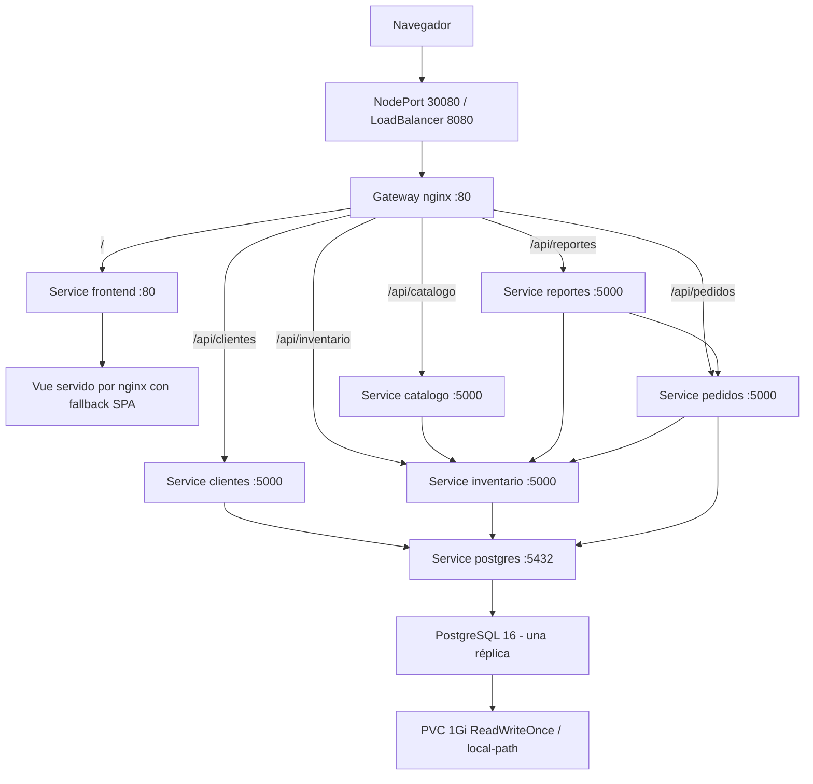

# Proyecto 2: El Quetzal en Kubernetes/k3s

Migración de la aplicación del Proyecto 1 a la VM Ubuntu Server con k3s. Se conservan los cinco microservicios Flask, Vue, PostgreSQL 16, las tres bases y los contratos HTTP. La demostración del Proyecto 2 se ejecuta exclusivamente con Kubernetes.

Rama: `project2/kubernetes`, basada en `main` commit `2e3d9baf557ea3c0f9fda9fbccb56c949dfbd884`. No se hace merge a `main` ni se crea otro repositorio. `docker-compose.yml` y `docker-compose.dev.yml` permanecen como referencia del Proyecto 1. El gateway de esta rama está adaptado a Kubernetes; el Compose histórico necesita su configuración original para volver a ejecutar el Proyecto 1.

## Equipo y nomenclatura

Grupo **Glitch Tec**:

| Integrante | Carné |
|---|---|
| Mario Arévalo | 1072123 |
| Jonatán Chávez | 1185023 |
| Javier Ruano | 1207022 |
| Javier Aldana | 1184523 |
| Hector Pérez | 1304223 |
| José Rosales | 1143323 |

Los registros se siembran en `clientes_db`; el Dashboard obtiene los nombres y carnés con `GET /api/clientes`. No simula los nombres cuando el backend falla. Advierte si falta alguno de los seis registros.

El enunciado solicita `proyecto_2_<idEquipo>` para carpeta, repositorio y namespace. Kubernetes exige nombres DNS y no permite `_` en el namespace: se usa `proyecto-2-<idEquipo>`. Se conserva **`__ID_EQUIPO__`** en las plantillas; ese token tampoco es un nombre desplegable.

El ID oficial aún no está confirmado. Solo si nunca se asignó uno se utilizará `glitch-tec`. La carpeta y el futuro repositorio serán `proyecto_2_<idEquipo>`; por ahora seguimos en el repositorio existente. El enunciado también menciona imágenes `usuario-<carné>`; por instrucción del equipo se usa `javierini/elquetzal-<servicio>:2.0`. Registrar esta correspondencia en las evidencias.

```bash
./scripts/configure-project.sh <id-equipo-confirmado>
# Ejemplo exclusivamente cuando se haya confirmado el valor alternativo:
./scripts/configure-project.sh glitch-tec
```

Requiere Python 3. Valida 1-40 caracteres en minúsculas, números y guiones, con extremos alfanuméricos. Sustituye el token únicamente en `.generated/<id>/k8s/` y `.generated/<id>/gateway/nginx.conf`; conserva las plantillas versionadas. Genera también los ConfigMaps desde el SQL y nginx originales. No despliega recursos ni modifica main. Volver a configurarlo sobrescribe las copias generadas, incluyendo cambios de réplicas hechos allí.

En PowerShell se puede usar `python scripts/project.py configure <id>`. En la VM Linux se utilizan los scripts Bash. Los Pods tienen `hostname: <servicio>-<id>`; se puede mostrar con `kubectl exec ... -- hostname`. El hostname de la VM se comprueba aparte, sin que los scripts cambien el sistema.

## Arquitectura



Todos los recursos propios pertenecen al namespace del equipo. La comunicación usa DNS de Services; no usa IPs de Pods ni IPs internas fijas. Los Services seleccionan `app`, `project: el-quetzal` y `team` idénticos a los labels de cada Pod.

## Archivos

```text
k8s/
  namespace.yaml
  config/      app-configmap.yaml, postgres-init-configmap.yaml
  db/          postgres-pvc.yaml, postgres-deployment.yaml, postgres-service.yaml
  app/         frontend y cinco backends: *-deployment.yaml
  services/    frontend y cinco backends: *-service.yaml
  gateway/     gateway-configmap.yaml, gateway-deployment.yaml,
               gateway-nodeport.yaml, gateway-loadbalancer.yaml
scripts/
  configure-project.sh       genera archivos con un ID válido
  create-secret.sh           crea el Secret sin versionar credenciales
  build-push-images.sh       build local o push explícito
  validate-manifests.sh      validación estática y dry-run opcional
  project.py                render y sincronización de ConfigMaps
  prepare-secret.py         lectura y validación de credenciales
  validate-manifests.py      contratos y referencias de los YAML
  requirements.txt          PyYAML para validación
config/credentials.env.example  plantilla vacía
docs/VALIDACION_VM.md        pasos de despliegue y diagnóstico
docs/EVIDENCIAS.md           capturas A-F pendientes
docs/AUDITORIA_PROYECTO1.md  contratos y problemas heredados
docs/INFORME_IMPLEMENTACION.md  informe y resultados reales
```

## Imágenes

| Componente | Imagen | Contexto de build | Puerto |
|---|---|---|---|
| catálogo | `javierini/elquetzal-catalogo:2.0` | `services/catalogo` | 5000 |
| clientes | `javierini/elquetzal-clientes:2.0` | `services/clientes` | 5000 |
| inventario | `javierini/elquetzal-inventario:2.0` | `services/inventario` | 5000 |
| pedidos | `javierini/elquetzal-pedidos:2.0` | `services/pedidos` | 5000 |
| reportes | `javierini/elquetzal-reportes:2.0` | `services/reportes` | 5000 |
| frontend | `javierini/elquetzal-frontend:2.0` | `frontend` | 80 |
| gateway | `javierini/elquetzal-gateway:2.0` | raíz, `-f gateway/Dockerfile` | 80 |
| PostgreSQL | `postgres:16` | imagen oficial | 5432 |

```bash
DOCKERHUB_USER=javierini IMAGE_TAG=2.0 ./scripts/build-push-images.sh build
# Después de que el responsable se autentique manualmente en Docker Hub:
DOCKERHUB_USER=javierini IMAGE_TAG=2.0 ./scripts/build-push-images.sh push
```

El script no hace login ni guarda credenciales. Por defecto construye; `push` exige credenciales disponibles en la configuración local o su helper, comprueba que las siete imágenes existen y deja a Docker validar la sesión real. El gateway lleva una plantilla; Kubernetes monta el nginx configurado desde ConfigMap. Para un `nginx -t` local fuera del clúster se necesita montar la copia generada y proporcionar resolución DNS de los Services.

El frontend usa build multi-stage Node 22/nginx y `npm ci`. El Node local debe cumplir `frontend/package.json` (preferir 22.22.2 o superior compatible). No cambiar el lockfile para evadir un requisito de Node.

## Configuración y credenciales

`app-config-<id>` contiene `DB_HOST=postgres-<id>`, `DB_PORT=5432`, las bases `inventario_db`, `clientes_db`, `pedidos_db`, `UMBRAL_STOCK_BAJO=10`, `INVENTARIO_URL` y `PEDIDOS_URL`. Cada backend recibe su base como `DB_NAME` mediante `configMapKeyRef`.

El Secret `db-credentials-<id>` se crea localmente con ocho claves: `POSTGRES_ADMIN_USER/PASSWORD`, `INVENTARIO_DB_USER/PASSWORD`, `CLIENTES_DB_USER/PASSWORD` y `PEDIDOS_DB_USER/PASSWORD`. Los cuatro usuarios deben ser distintos. Los Deployments usan `secretKeyRef`, mapeando `POSTGRES_ADMIN_USER` a `POSTGRES_USER` y los usuarios de servicio a `DB_USER`/`DB_PASSWORD`.

```bash
mkdir -p secrets
cp config/credentials.env.example secrets/database.secret
chmod 600 secrets/database.secret
nano secrets/database.secret
./scripts/create-secret.sh <id> secrets/database.secret
```

También acepta las ocho variables exportadas, sin archivo; tienen prioridad sobre el archivo. No usar `source`: el lector solo acepta pares `CLAVE=valor` sin ejecutar código. La plantilla no incluye contraseñas ni usuarios reales. Se recomiendan usuarios `admin`, `inventario_user`, `clientes_user`, `pedidos_user` y contraseñas distintas generadas localmente. El bootstrap ya aceptaba solo un conjunto restringido de caracteres; el backend construye una URI sin escaping. Para conservar ambos se admiten contraseñas con letras, números, `.`, `_` y `-`; una cadena aleatoria hexadecimal es compatible. No se modifica el contrato Python para esta migración.

El Secret real, `*.secret`, credenciales locales y `.generated` están ignorados. `create-secret.sh` crea el namespace antes del Secret, usa un temporal con permisos privados y lo elimina al salir. No ejecutar con `bash -x` ni capturar `kubectl get secret -o yaml`, variables o archivos de credenciales. Cambiar el Secret no cambia los roles de una BD ya inicializada: la rotación requiere actualizar PostgreSQL y reiniciar backends con los valores correspondientes.

## PostgreSQL e inicialización

Deployment de una réplica y estrategia `Recreate`, PVC 1Gi `ReadWriteOnce` con `local-path`, montado en `/var/lib/postgresql/data`. `PGDATA` queda en su subcarpeta `pgdata`, evitando archivos ajenos en la raíz del volumen. No utiliza `hostPath`.

El ConfigMap de inicialización reproduce `init-databases.sh`, `schema/` y `seeds/` en `/docker-entrypoint-initdb.d`, con permiso ejecutable y solo lectura. Se conserva la lógica de roles, bases, schemas y seeds; únicamente se eliminan las tres contraseñas por defecto heredadas para exigir valores del Secret. `PGHOST=/var/run/postgresql` conserva el socket interno del Proyecto 1. La imagen oficial ejecuta el bootstrap solo al iniciar un volumen vacío.

Las probes de PostgreSQL usan TCP a `127.0.0.1`, porque el servidor temporal del bootstrap solo atiende el socket y no debe habilitar los backends prematuramente. Clientes, inventario y pedidos esperan el Service en 5432 con un initContainer BusyBox. Las probes HTTP existentes no verifican la BD continuamente; el CRUD es la comprobación funcional real.

Cambiar ConfigMaps no vuelve a sembrar un PVC inicializado. La guía incluye un comando para aplicar únicamente el seed de clientes al volumen existente sin borrar datos. Nunca eliminar el PVC como prueba de persistencia.

## Gateway, Services y orden de despliegue

El gateway nginx usa DNS de Services con `<id>`. Conserva `/health`, prefijos completos `/api/...` y headers Host/Real-IP/Forwarded. `proxy_pass` no añade una URI que recorte el prefijo. `/` se reenvía al Service frontend; su nginx soporta `/`, `/inventario` y `/pedidos` con fallback SPA.

Siete Services ClusterIP: frontend 80, cinco backends 5000, PostgreSQL 5432. Un NodePort del gateway usa `80 → 80`, puerto de nodo 30080. Otro Service del gateway es LoadBalancer `8080 → 80`. Se elige 8080 porque el Traefik incluido en k3s puede ocupar 80/443. La IP externa y el acceso desde host quedan sujetos a la VM y su red; no se fija una EXTERNAL-IP. Referencia: [Networking Services de k3s](https://docs.k3s.io/networking/networking-services).

Orden: confirmar nodo e ID → namespace/Secret → ConfigMaps → Service PostgreSQL/PVC/Deployment → esperar PostgreSQL → frontend/backends y ClusterIP → esperar Pods/endpoints → gateway → NodePort y LoadBalancer. El script del Secret aplica primero el namespace; la guía vuelve a aplicarlo de forma idempotente. PostgreSQL necesita su Service antes de que los initContainers intenten resolverlo.

La guía copiable completa está en [docs/VALIDACION_VM.md](docs/VALIDACION_VM.md). Las capturas requeridas están en [docs/EVIDENCIAS.md](docs/EVIDENCIAS.md). Después de cambiar nginx aplicar ConfigMap y reiniciar gateway, pues nginx carga su configuración al iniciar. Después de cambiar variables de entorno aplicar ConfigMap/Secret y reiniciar los Deployments consumidores. Referencia: [ConfigMaps de Kubernetes](https://kubernetes.io/docs/concepts/configuration/configmap/).

## Validación

```bash
python3 -m pip install -r scripts/requirements.txt
./scripts/validate-manifests.sh
# Con kubectl y su API accesible:
./scripts/validate-manifests.sh --kubectl <id>
```

La validación estática sustituye el token en memoria con `validacion-local`; no asigna un ID oficial. Verifica YAML, labels/selectors, nombres DNS, imágenes, puertos, probes reales, variables contra código, referencias ConfigMap/Secret/PVC, mounts, SQL sincronizado, fallback SPA y carnés. No prueba el clúster.

Para regenerar ConfigMaps después de modificar SQL o nginx:

```bash
python3 scripts/project.py sync-configmaps
./scripts/configure-project.sh <id>
```

La compilación local de Vue y los controles estáticos se ejecutaron; consulta el informe para sus resultados y limitaciones. No se afirma que haya Pods Running, PVC Bound, endpoints, CRUD, persistencia, escalado, autoreparación o acceso de red hasta probarlos en la VM. Construcción/publicación de imágenes y confirmación del ID son preparativos adicionales, realizables fuera de la VM.
